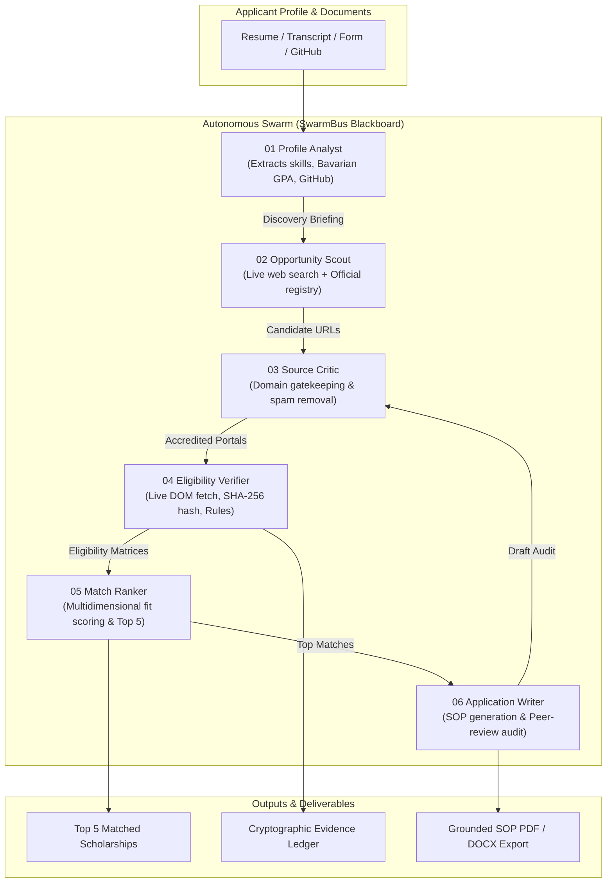

# ScholarSwarm: Autonomous AI Scholarship Swarm

ScholarSwarm is an autonomous multi-agent intelligence swarm designed to discover, verify, rank, and draft applications for international scholarships and fellowships. It combines live web crawling, official domain verification, deterministic eligibility computation, and grounded LLM synthesis with anti-hallucination peer review.

---

## Table of Contents

- [Key Features](#key-features)
- [Swarm Architecture & Agent Roles](#swarm-architecture--agent-roles)
- [Project Directory Structure](#project-directory-structure)
- [Prerequisites](#prerequisites)
- [Quick Start & Setup Commands](#quick-start--setup-commands)
  - [1. Clone Repository & Navigate](#1-clone-repository--navigate)
  - [2. Create & Activate Virtual Environment](#2-create--activate-virtual-environment)
  - [3. Install Dependencies](#3-install-dependencies)
  - [4. Configure Environment Variables](#4-configure-environment-variables)
  - [5. Launch the Application](#5-launch-the-application)
- [Configuration Guide](#configuration-guide)
  - [Supported LLM Providers](#supported-llm-providers)
  - [Optional Integrations](#optional-integrations)
  - [Zero-LLM Offline / Fallback Mode](#zero-llm-offline--fallback-mode)
- [API Reference](#api-reference)
- [Security & Anti-Hallucination Guarantees](#security--anti-hallucination-guarantees)
- [License](#license)

---

## Key Features

- **Autonomous 6-Agent Swarm**: Specialized agents communicate asynchronously via an in-memory blackboard and event bus (`SwarmBus`).
- **Deep Profile Ingestion**:
  - Ingests resumes and transcripts in PDF, DOCX, and TXT formats (up to 8 MB).
  - Automatically extracts candidate CGPA, scale, core competencies, and project portfolio.
  - Live GitHub profile analysis (repositories, languages, stars, commit activity).
  - Automated Bavarian Formula conversion to German/European grading scales.
- **Dual-Engine Scholarship Discovery**:
  - Curated, verified repository of prestigious government and university scholarship programs.
  - Dynamic live web scout powered by Tavily API or automated DuckDuckGo live browser search.
- **Live Official Verification & Cryptographic Citations**:
  - Fetches and parses live official `.edu`, `.gov`, `.ac.uk`, `.org`, and university domains.
  - Computes SHA-256 cryptographic hashes of retrieved pages with HTTP status codes and live fetch timestamps.
  - Automatically filters out commercial blogs, content aggregators, and dead links.
- **Deterministic Eligibility Evaluation**:
  - Mathematical rule engine evaluates minimum CGPA, target degree level, citizenship, subject relevance, and language requirements.
  - Completely separates eligibility decisions from LLM generation to eliminate false positives.
- **Multidimensional Match Scoring**:
  - Algorithmic scoring across academic margin, funding coverage, destination alignment, and deadline proximity.
  - Detailed breakdown of fit rationale for each opportunity.
- **Grounded Statement of Purpose (SOP) Synthesis**:
  - Generates tailored, academic Statements of Purpose grounded strictly in verified applicant evidence.
  - Employs an automated **Source Critic peer review** to flag unsupported claims and insert explicit `[ACTION REQUIRED]` markers for missing institutional specifics.
- **One-Click Export**:
  - Direct server-side compilation of customized Statements of Purpose to **PDF** (via ReportLab) and **DOCX** (via python-docx).
- **Modern Real-Time UI**:
  - Clean, reactive interface with real-time Server-Sent Events (SSE) telemetry.
  - Professional Lucide vector icon system (zero raw emojis).
  - Works out of the box with zero npm/frontend build step.

---

## Swarm Architecture & Agent Roles



| Agent | ID | Primary Responsibilities |
| :--- | :---: | :--- |
| **Profile Analyst** | `01` | Parses uploaded documents (PDF/DOCX), queries GitHub API for repository analytics, calculates Bavarian GPA, and generates the Swarm Discovery Briefing. |
| **Opportunity Scout** | `02` | Formulates targeted queries based on applicant profile, performs live web queries via Tavily/DuckDuckGo, and merges with accredited registry pools. |
| **Source Critic** | `03` | Verifies domains against university and government whitelist criteria, strips aggregator spam, and performs automated peer review on generated SOP drafts. |
| **Eligibility Verifier** | `04` | Dispatches concurrent crawlers to official portals, computes SHA-256 content hashes, parses requirements, and evaluates the deterministic rule engine. |
| **Match Ranker** | `05` | Computes weighted multidimensional compatibility scores (academic, financial, geographic, discipline) and selects the Top 5 opportunities. |
| **Application Writer** | `06` | Drafts a tailored Statement of Purpose restricted strictly to verified facts, inserting `[ACTION REQUIRED]` flags where personal evidence is needed. |

---

## Project Directory Structure

```
scholarswarm/
├── backend/
│   ├── app/
│   │   ├── __init__.py
│   │   ├── config.py             # Environment configuration & directory paths
│   │   ├── main.py               # FastAPI application, REST endpoints, SSE stream & static files
│   │   ├── models.py             # Pydantic schemas (Profile, Draft, Export)
│   │   ├── orchestrator.py       # SwarmBus blackboard, agent state machine & event logging
│   │   ├── rules.py              # Deterministic eligibility evaluation rules engine
│   │   ├── agents/
│   │   │   ├── profile_analyst.py      # Agent 01: Resume, transcript & GitHub extraction
│   │   │   ├── opportunity_scout.py    # Agent 02: Multi-query live web discovery
│   │   │   ├── source_critic.py        # Agent 03: Domain auditor & SOP anti-hallucination checker
│   │   │   ├── eligibility_verifier.py  # Agent 04: Live crawling, SHA-256 hashing & validation
│   │   │   ├── match_ranker.py         # Agent 05: Multi-attribute scoring & ranking
│   │   │   └── application_writer.py   # Agent 06: Grounded SOP synthesis
│   │   └── tools/
│   │       ├── fetcher.py        # Async HTTP client with retry, backoff & DOM text extraction
│   │       ├── github.py         # GitHub API client (repositories, tech stack, activity)
│   │       ├── llm.py            # OpenAI-compatible LLM client (Groq, OpenAI, Gemini, etc.)
│   │       ├── parsing.py        # PDF, DOCX, regex CGPA & skills extractors
│   │       └── search.py         # Multi-provider web search (Tavily + DuckDuckGo fallback)
│   ├── data/
│   │   └── opportunities.json    # Curated official scholarship registry & criteria
│   ├── runs/                     # Persisted swarm execution runs and logs (.gitkeep)
│   ├── requirements.txt          # Python backend dependencies
│   ├── .env.example              # Sample environment configuration
│   └── .env                      # Local environment configuration (git-ignored)
├── frontend/
│   ├── index.html                # Modern landing page & architecture overview
│   ├── app.html                  # Interactive Swarm console, live monitor & SOP editor
│   ├── css/
│   │   └── styles.css            # Custom responsive styling and dark mode design
│   └── js/
│       ├── app.js                # Frontend controller, form handling & SSE streaming
│       ├── icons.js              # Lucide vector icons renderer
│       └── landing.js            # Landing page interactivity
├── docs/
│   ├── architecture.md           # Swarm architecture and failure recovery specs
│   └── SUBMISSION_NOTE.md        # Technical design notes & engineering insights
├── .gitignore                    # Git ignore specifications
└── README.md                     # Project documentation
```

---

## Prerequisites

- **Python**: Version `3.10` or higher (`python --version`)
- **Web Browser**: Any modern browser (Google Chrome, Microsoft Edge, Mozilla Firefox, Safari)
- **Internet Access**: Required for live official website fetching and web discovery

---

## Quick Start & Setup Commands

### 1. Clone Repository & Navigate

```bash
git clone https://github.com/your-username/scholarswarm.git
cd scholarswarm
```

### 2. Create & Activate Virtual Environment

**Windows (PowerShell):**
```powershell
cd backend
python -m venv venv
.\venv\Scripts\Activate.ps1
```

**Windows (Command Prompt):**
```cmd
cd backend
python -m venv venv
venv\Scripts\activate.bat
```

**macOS / Linux:**
```bash
cd backend
python3 -m venv venv
source venv/bin/activate
```

### 3. Install Dependencies

```bash
pip install --upgrade pip
pip install -r requirements.txt
```

### 4. Configure Environment Variables

Copy the example environment configuration:

**Windows (PowerShell):**
```powershell
Copy-Item .env.example .env
```

**macOS / Linux:**
```bash
cp .env.example .env
```

Open `.env` in your editor and configure your preferred LLM provider (see [Configuration Guide](#configuration-guide) below).

### 5. Launch the Application

Run the FastAPI application with Uvicorn:

```bash
python -m uvicorn app.main:app --host 0.0.0.0 --port 8000 --reload
```

The application is now live at:
- **Landing Page**: [http://localhost:8000](http://localhost:8000)
- **Swarm Dashboard**: [http://localhost:8000/app.html#profile](http://localhost:8000/app.html#profile)
- **Interactive API Documentation (Swagger)**: [http://localhost:8000/docs](http://localhost:8000/docs)
- **Alternative API Docs (ReDoc)**: [http://localhost:8000/redoc](http://localhost:8000/redoc)

---

## Configuration Guide

ScholarSwarm uses an OpenAI-compatible client interface in `backend/app/tools/llm.py`, allowing you to connect to any standard LLM provider without changing application code. Provider keys like `GROQ_API_KEY`, `OPENAI_API_KEY`, and `GEMINI_API_KEY` are also automatically detected and set up with sensible defaults.

### Supported LLM Providers

#### Option 1: Groq (Recommended — Ultra-Fast Inference)
1. Sign up for a free account at [console.groq.com](https://console.groq.com).
2. Create an API key.
3. Update `backend/.env` (or simply set `GROQ_API_KEY=gsk_...`):
   ```ini
   LLM_API_KEY=gsk_your_groq_api_key_here
   LLM_BASE_URL=https://api.groq.com/openai/v1
   LLM_MODEL=openai/gpt-oss-120b
   ```

#### Option 2: OpenAI
```ini
LLM_API_KEY=sk-your_openai_api_key_here
LLM_BASE_URL=https://api.openai.com/v1
LLM_MODEL=gpt-4o-mini
```

#### Option 3: Google Gemini (OpenAI-Compatible Endpoint)
```ini
LLM_API_KEY=AIzaSy_your_gemini_api_key_here
LLM_BASE_URL=https://generativelanguage.googleapis.com/v1beta/openai
LLM_MODEL=gemini-2.0-flash
```

#### Option 4: Local Models (Ollama / vLLM / LM Studio)
Run fully offline and local:
```ini
LLM_API_KEY=ollama
LLM_BASE_URL=http://localhost:11434/v1
LLM_MODEL=llama3.3
```

### Optional Integrations

- **Tavily Web Search**:
  Add `TAVILY_API_KEY=tvly-...` for accelerated parallel web search. If left empty, ScholarSwarm automatically falls back to live DuckDuckGo web search.
- **GitHub API Token**:
  Add `GITHUB_TOKEN=ghp_...` to increase rate limits when deep-inspecting student repositories. If left blank, unauthenticated public requests are used.
- **Crawl Tuning**:
  ```ini
  LIVE_FETCH=1         # Enable live HTTP crawling of official portals
  LIVE_DISCOVERY=1     # Enable live search discovery
  MAX_CONCURRENCY=5    # Concurrent crawler threads
  FETCH_TIMEOUT=12     # Web request timeout in seconds
  ```

### Zero-LLM Offline / Fallback Mode

ScholarSwarm is architected with complete resilience:
- If no `LLM_API_KEY` is provided, **the swarm still functions 100%**:
  - Profile analysis extracts facts via heuristic and deterministic NLP extractors.
  - Eligibility verification runs via the deterministic Python rule engine.
  - Fit notes and Statement of Purpose use structured academic templates with explicit placeholders.
- The UI status indicator will show `LLM: Offline (Template Mode)` and gracefully complete every phase.

---

## API Reference

| Method | Endpoint | Description |
| :--- | :--- | :--- |
| `GET` | `/api/health` | Returns service health, LLM connectivity, active model, and search engine. |
| `GET` | `/api/stats` | Returns registry counts, supported countries, and active agent roster. |
| `POST` | `/api/upload` | Ingests resume/transcripts (multipart form), extracts text, CGPA, skills, and projects. |
| `POST` | `/api/swarm/start` | Accepts a student `Profile` JSON payload, initializes blackboard, and starts swarm. |
| `GET` | `/api/swarm/{run_id}/stream` | Server-Sent Events (SSE) stream delivering real-time logs, messages, and progress. |
| `GET` | `/api/swarm/{run_id}/state` | Fetches snapshot of all 6 agent statuses, progress percentages, and events. |
| `GET` | `/api/swarm/{run_id}/result` | Retrieves final ranked matches, verified criteria, audit report, and draft. |
| `POST` | `/api/draft` | Generates a targeted Statement of Purpose for an opportunity with Source Critic audit. |
| `POST` | `/api/export` | Compiles the Statement of Purpose into downloadable `pdf` or `docx`. |

---

## Security & Anti-Hallucination Guarantees

1. **Deterministic Rule Separation**:
   Eligibility (GPA, degree level, nationality, language) is computed strictly by deterministic rule algorithms. The LLM never decides whether an applicant qualifies.
2. **Strict Document Grounding**:
   The Application Writer is constrained to facts present in the applicant's submitted documents. Any unconfirmed institutional facts are preserved as visible `[ACTION REQUIRED: ...]` prompts for human completion.
3. **Automated Peer Review**:
   The **Source Critic (Agent 03)** inspects generated drafts, cross-checking every GPA reference, project title, and institution against the profile ledger.
4. **Cryptographic Proofs**:
   All verified portal citations include the official URL, HTTP response status code, exact verification timestamp, and a SHA-256 digest of the crawled page content.

---

## License

This project is licensed under the MIT License — see the [LICENSE](LICENSE) file for details.
