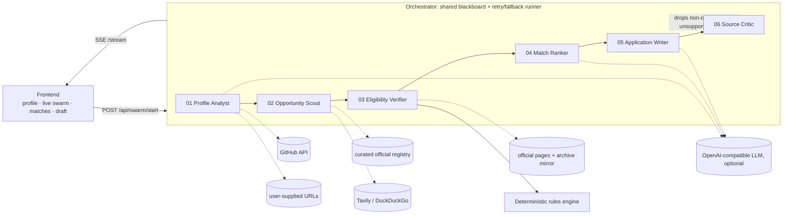

# ScholarSwarm architecture

## Message flow (blackboard)

| Agent | Reads | Writes |
|---|---|---|
| 01 Profile Analyst | form, resume, transcript, GitHub, extra URLs | `enriched` profile, strengths, score |
| 02 Opportunity Scout | `enriched` | `candidates` (registry + live web, official domains only) |
| 03 Eligibility Verifier | `candidates`, `enriched` | citations (status, hash, time), deadline evidence, eligibility matrix |
| 04 Match Ranker | matrices | scores, `top5`, fit notes |
| 05 Application Writer | top pick, `enriched` | SOP draft with `[ACTION REQUIRED]` placeholders |
| 06 Source Critic | everything | audit, removes non-official picks, flags unsupported draft claims |

## Failure recovery

- Every agent runs under `step()`: retry, then a deterministic fallback.
- Page fetch: retry with backoff, then official fallback URLs, then an archive snapshot (labelled), else "unverified".
- LLM missing or failing: every agent has a rules/template path, so the swarm always completes.
- GitHub down: continue with resume evidence only.

## Adapting to a new profile (the live surprise)

Nothing is hard-coded to Rahul. Scoring, discovery queries and the SOP are all driven by the submitted profile
(degree level, field, destinations, funding need, IELTS, work experience). Load the `Ananya` sample, or type any profile, and press Deploy.
